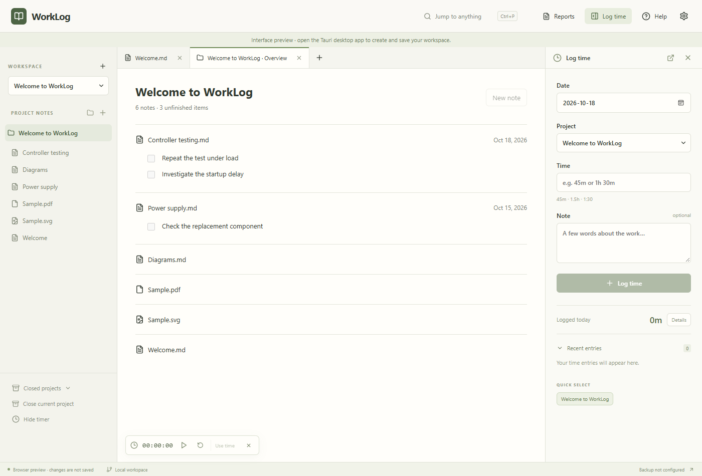
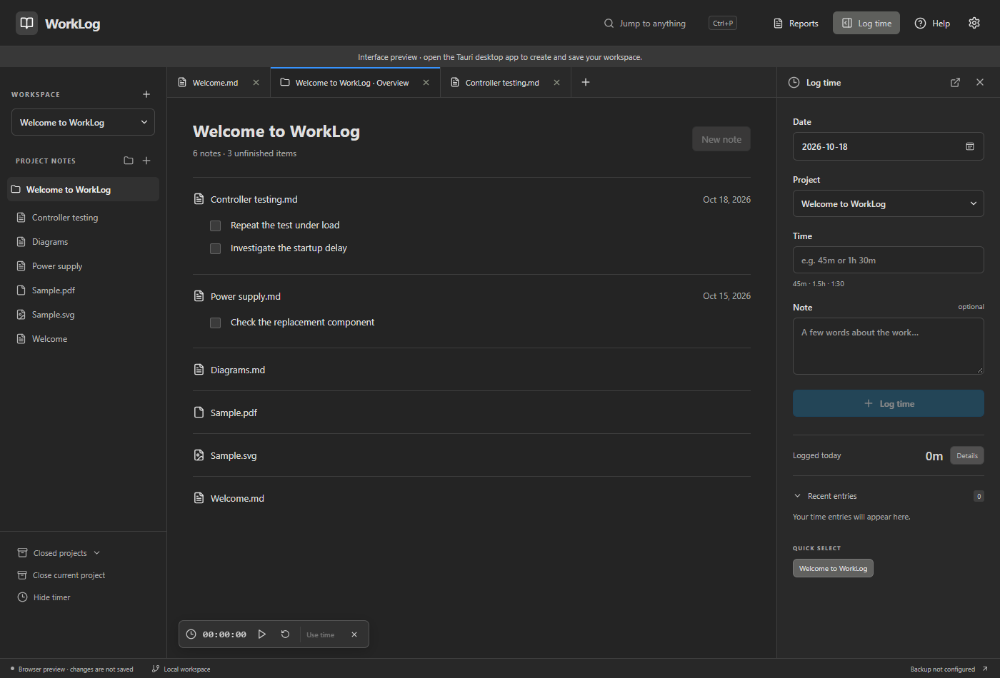

<div align="center">

# WorkLog

### Project notes and time tracking in a local desktop app

[Getting started](#getting-started) · [Screenshots](#screenshots) · [User guide](docs/user-guide.md) · [LLM connection](docs/mcp.md)

</div>



## Features

- **Project notes:** Organize Markdown and text files by project and folder, create dated daily logs, and open multiple notes in tabs.
- **Unfinished tasks:** See unchecked Markdown tasks in the project overview and jump to their source notes.
- **Time tracking:** Enter durations such as `45m`, `1.5h`, or `1:30`, or copy elapsed time from the timer into an entry. Edit past entries by work date, project, and description.
- **Timesheets:** Review daily and project totals for a preset or custom date range, then export Markdown.
- **Search:** Search note text across projects, including closed projects, and open matching lines.
- **Attachments and diagrams:** View images and PDFs beside notes and render Mermaid diagrams in Markdown.
- **Appearance and shortcuts:** Choose light, dark, or system appearance and customize keyboard shortcuts.

## LLM connection

A compatible assistant can read your notes, time entries, and Git history through WorkLog's read-only MCP endpoint. Use it to summarize a period of work, find past decisions, or draft a performance review from your records.

Sharing is off at launch. Start it in **Settings → LLM data access (MCP)**. Connections require a bearer token; network connections also require TLS. The assistant generates responses and uses its own connections to access linked tickets or documents.

See the [connection guide and tool reference](docs/mcp.md) for setup, supported tools, and retrieval examples.

## Screenshots

The workspace above uses light appearance; dark appearance is shown below.



*Screenshots show the browser interface preview with bundled sample data. Saving notes and time requires the desktop app.*

## Getting started

1. Launch the WorkLog desktop app and choose an empty local data folder, or open an existing WorkLog workspace.
2. Create a project, then add a note or use **Today's log** to start a dated daily entry.
3. Write your notes. Add Markdown checkboxes for tasks you want listed in the project overview.
4. Log your time with a work date, project, duration, and description.
5. Open **Reports** to review a period and export a Markdown timesheet.

The [user guide](docs/user-guide.md) covers shortcuts, attachments, time corrections, history, backups, and workspace recovery.

## Your data and backups

Project notes live in local Markdown and UTF-8 text files; time records live in `time.jsonl`. The workspace is separate from this application source repository.

WorkLog supports local Git history, scheduled backups to a Git remote or folder, and manual backups. Git history requires Git on your PATH. Scheduled backups run while the app is open, and remote backups use your existing SSH keys or Git credential helper.

See [history and backups](docs/user-guide.md#history-and-backups) for scheduling, restore steps, and what backups include.

## Development

Built with **Tauri 2, React 19, TypeScript, Rust, and CodeMirror 6**.

### Prerequisites

- Node.js **22.13 or newer** and npm.
- Git and a Rust toolchain.
- Windows: compatible C++ build tools and WebView2.
- Ubuntu 22.04: GTK/WebKit build dependencies listed in the [development guide](docs/user-guide.md#development).

### Run locally

```sh
npm ci
npm run tauri dev
```

For an interface-only browser preview:

```sh
npm run dev
```

The browser preview uses sample data and cannot save a real workspace.

### Check and build

```sh
npm test
npm run build
cargo test --manifest-path src-tauri/Cargo.toml
npm run tauri build
```

The included [GitHub Actions workflow](.github/workflows/build.yml) runs checks and builds Windows NSIS installers and Ubuntu 22.04 DEB/AppImage packages. Local build output is under `src-tauri/target/release/`; packaged installers are under its `bundle/` directory. Ubuntu 20.04 compatibility is not verified.

See the [build guide](docs/user-guide.md#build-and-checks) for the Windows helper script and additional build details.

## Documentation

- [User guide](docs/user-guide.md) — everyday workflows, shortcuts, data formats, and backups.
- [LLM connection guide](docs/mcp.md) — MCP setup, authentication, tools, and retrieval examples.
- [Product specification](SPEC.md) — requirements and implementation context.
- [Project review design](docs/project-review.md) — review evidence, current capabilities, and proposed workflows.

<details>
<summary>Compatibility with earlier WorkNotes versions</summary>

WorkLog was previously named WorkNotes. Existing data, settings, drafts, and backup destinations remain compatible. Internal package/executable names, application identifiers, storage keys, the `worknotes.json` marker, and the `WorkNotes-backup` folder retain their original names to preserve existing workspaces.

</details>
