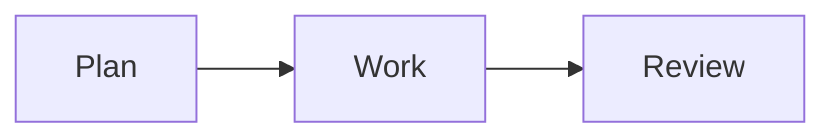

# WorkLog

A local work logbook for task notes, tests, outcomes, and time tracking. Built with Tauri 2, React, TypeScript, and CodeMirror 6. The product requirements are in [SPEC.md](../SPEC.md).

The executable is named `worklog` (`worklog.exe` on Windows), and the Debian package is `work-log`. The application identifier is `local.worklog.desktop`, the workspace marker is `worklog.json`, and folder backups use `WorkLog-backup`.

## Development

See the [development guide](development.md) for prerequisites, fresh-clone setup, desktop execution, browser-preview limitations, and troubleshooting. Follow [CONTRIBUTING.md](../CONTRIBUTING.md) for expected development practices.

## Build and checks

See [development checks and packaging](development.md#checks) and the [release guide](releasing.md). CI packages Windows and Ubuntu 22.04; Ubuntu 20.04, macOS, and ARM support are unverified. Clean-machine installation tests are separate from automated checks.

## Using WorkLog

Click the task name at the top of the notes tree to open its overview. Notes containing unfinished Markdown checkboxes (`- [ ] Follow up`) appear first, with the most recently edited notes first in each group. Check an item directly to update its original note, or click its text to open the note at that line. Note titles open their files. The overview stays stationary while you use it; completed items remain visible until you leave and reopen it. Dates come from file modification times and can change when files are copied or cloned. There is no separate task store.

1. Choose an empty local data folder or open existing WorkLog data.
2. Type a task name into the task field and select Create (or press Enter).
3. Press Ctrl+N or use + to add a note. Enter its name and press Enter to start writing immediately. Notes default to the task root; optionally enter a path such as `meetings/planning.md`. Add folders from the sidebar. Prose wraps in a regular reading font; blockquotes and fenced code use monospace and stay within the editor width. Each block scrolls its own long lines horizontally without moving the rest of the note.
4. Use Ctrl+P to find a task or note; Ctrl+F searches a note, Ctrl+W closes its tab.
5. Log a date, task, project code, duration (`45m`, `1.5h`, `1:30`), and optional note.
6. Use Reports to choose inclusive dates and export Markdown.

Ctrl+Shift+L toggles the docked Log time panel; Ctrl+Shift+T toggles its popup. Both keep the current entry draft. These are app shortcuts, not system-wide shortcuts. Settings → Appearance offers System, Light, and Dark modes; the choice persists across restarts and includes the notes editor.

Help starts a guided tour with popups pointing at the main features. Use Back/Next, Skip, or Escape, and replay it whenever needed. Creating your first task is guided directly at the task selector rather than through Settings.

Help → Keyboard shortcuts, Settings → Keyboard shortcuts, or F1 opens the shortcut reference. The final tour step also links there. Click an app shortcut and press a new combination to change it, or clear it; duplicate assignments and reserved editing keys are rejected. Changes save automatically on this computer. Reset to defaults restores the original bindings. Common fixed editing/navigation controls are listed below the app shortcuts. Tooltips and tour text show your chosen bindings.

The corner timer records start/stop timestamps, including elapsed time while asleep or closed. Use time copies whole elapsed minutes into the form; it never logs automatically. Stop before starting another interval. Reset clears only timer state.

Notes save after a short idle interval. External modifications cause a save conflict instead of overwriting another edit; the current draft remains in the editor. Logged today shows the total and a Details button. Details lists that date's time entries and task totals; edit the date, task, duration, or note, or remove an entry. Recent-entry Edit opens the same editor for that entry's date.

Time remains plaintext in `time.jsonl`, with one current JSON entry per line. Edits update the same ID and removals delete the entry; the complete file is replaced atomically. Git retains previous versions. Stale edits/removals are rejected rather than overwriting newer changes. Incomplete time-file lines are reported without silently repairing or deleting them.

## Workspace format

WorkLog opens format 3 only. New workspaces include empty project-code storage and a global-notes root. Opening, cloning, and restoring reject unsupported formats without changing their data. No workspace upgrade command is included.

The full product rename changes the application data directory, UI preference keys, workspace marker, lock filename, and backup directory. Settings and UI preferences from earlier builds are not imported. Reconfigure backups, reminders, and MCP as needed. Folder backups now go to `WorkLog-backup`; earlier backup folders are retained separately.

To use an existing version-3 workspace from before this rename, close every app instance and back up the folder. Rename its root JSON marker to `worklog.json` and set its `format` field to `"worklog"`, keeping `version` at `3`. The marker should contain `{"format":"worklog","version":3}`. Add `.worklog.lock` and `.worklog-tmp*` to the workspace's `.gitignore`. Then choose that folder in WorkLog. Apply the same marker update to a restored copy of an earlier backup. Notes, attachments, project codes, and `time.jsonl` need no changes. Do not open the folder concurrently with an earlier build.

## Tasks, project codes, and Global notes

Tasks hold notes, daily logs, attachments, and overviews. Project codes independently group time across tasks. Select or create codes inline in the time form. Each task has a default; each entry stores its own code. Changing a default affects future entries only. Editing an entry loads its saved code. New tasks suggest the last successfully used active code. Renames update historical code labels; archiving preserves history but prevents new assignments until restored.

A partially filled time draft survives editor task navigation. The mismatch notice identifies its actual destination; Use current task explicitly retargets a new draft while retaining date, duration, and description. The timer fills that draft and never logs automatically.

Each task remembers its own tabs, order, focus, cursor, and scroll positions. Global tabs stay open across switches and show a Global marker and ownership breadcrumb. Global notes belong to this workspace. Their separate root opens a global-only overview of unchecked items, recent notes, and pins, without time totals. Global checkboxes do not appear in task overviews.

Ctrl+N creates a note in the selected task even while a global note is active. Use the [+] beside Global notes to create a global note. The creation dialog asks only for a name and shows the destination; switch tasks first to create a note or folder for another task. Today's log remains task-owned. Use Move or drag notes/folders between roots; occupied destinations are never overwritten. Global notes, attachments, and code metadata are included in Git history and backups. Tab sessions and recovery drafts remain machine-local.

## Notes and diagrams

Mermaid diagrams render directly below fenced `mermaid` blocks in Markdown notes. Use the note's **… → Insert Mermaid diagram** action to insert a starter block, or type:

````markdown

````

The source remains editable plaintext, and the preview updates after a short typing pause. Diagrams follow the app theme and work offline. Syntax errors appear beneath the source without changing it. `.txt` files keep this syntax as ordinary text.

Notes support `.md` and UTF-8 `.txt` files inside each task's `notes` directory. Files added there using the OS appear on the next workspace refresh (the background check runs every 30 seconds). Right-click notes for rename/move, deletion, opening the containing folder, moving to another task, or pinning to the top of the tree. Right-click folders to open them or delete empty directory trees. Drag folders or notes onto folders or Task root; occupied destinations are never overwritten. Tabs can be reordered by dragging and renamed through their context menu. Markdown exports suggest a filename containing the selected date range.

Images (`.png`, `.jpg`, `.jpeg`, `.gif`, `.webp`, `.bmp`, `.svg`, `.ico`) and `.pdf` files in the same notes directory open in read-only workspace tabs. Images support fit and zoom; PDFs support page navigation, fit-width, zoom, and passwords. Files are read on demand and released when their viewer closes. Binary files can be renamed (preserving their extension), moved, pinned, and deleted through the OS Recycle Bin/Trash. They are included in ordinary backups. PDF viewing uses bundled PDF.js, fonts, character maps, and decoders; it does not need internet access. The current PDF view renders pages without text selection or annotation editing. `npm run dev` and `npm run build` prepare the bundled PDF assets automatically.

## History and backups

The data folder is a separate Git repository. Git commits use a local WorkLog identity. Files save even if Git is missing; the status reports history errors. Background local history commits run every 30 seconds, without pushing or copying backups. Git must be on PATH for Git history and remote backups. WorkLog uses configured SSH keys or Git credential helpers and disables interactive credential prompts; authenticate with your provider outside the app first.

WorkLog disables Git hooks and external filesystem monitors for its Git commands, including opening workspaces, history reads, cloning, and backups. Hooks remain on disk for other Git clients, but WorkLog does not run them. Git attributes/filters and credential helpers are separate Git features; this is not a general sandbox for untrusted repositories.

External backups run once daily at the local time selected in Settings (default 17:00). While the app is open, the schedule is checked every 30 seconds. A background check shortly after startup catches up the most recent missed daily backup, including before today's scheduled time. WorkLog compares data contents with the last completed backup and skips unchanged data. Both configured destinations are attempted. Failed backups remain due and retry every 10 minutes while open; the status bar and Settings show the error. Back up now remains available. The app must be open to perform a backup; no separate service runs when it is closed. Backup progress and the last successful content fingerprint are kept in machine-local settings.

Settings can connect a remote to the current workspace, or clone an empty/existing WorkLog repository into a new local folder. Remote changes are not automatically merged and force-push is never used. A rejected push leaves local records intact.

Git backups require exactly one effective push destination matching the Remote URL displayed in Settings. A hidden push URL, multiple destinations, or a conflicting push rewrite stops the remote backup with an error; the configured file-copy backup is still attempted. Save backup settings to replace local push URLs with the chosen URL, even when the displayed URL has not changed. If the error persists, review inherited Git URL configuration. Saving settings does not push data immediately.

Whole-workspace backup coverage is intentional. All workspace files are eligible for Git history under its existing ignore rules, and file-copy backups include the entire folder and Git history. Keep passwords, private keys, and other secrets outside the workspace. There is no automatic secret scanner or file filtering; deleted files may remain in history and older backups.

Alternatively choose a backup parent folder, including a mounted network location. Back up now writes `WorkLog-backup` inside it, including Git history. It stages the new copy before replacing the old backup. It retains one completed snapshot. If replacement is interrupted, inspect the `.previous` directory before retrying. Keep this destination outside the working data folder.

Restore a remote backup by cloning it through Settings. Restore a file backup by copying `WorkLog-backup` to a local directory and choosing that folder. The app validates its format and ledger on opening.

Deletion asks for confirmation and moves files or empty folders to the OS Recycle Bin/Trash. Recover them using the OS file manager. If recycling fails, WorkLog asks separately before permanent deletion. New deletions create no private `.trash` copies. Legacy `.trash` folders from earlier versions are left for the user to manage; Git and older backups may already retain previous versions.

Workspace tabs/cursors, time-entry drafts, unsaved note recovery drafts, and timer state are machine-specific and stored in the webview's local storage, outside Git. Backups cover task data and history, not machine UI state.


## Review and development history

The [goal assessment and performance-review evidence design](project-review.md) describes current capabilities, gaps, and a proposed retrieval workflow. Time history in the Log time panel browses all tasks by Monday–Sunday week with a date jump and entry editing. The time form follows local today unless you explicitly choose a date; Use today resumes automatic dating. Existing saved entries are never automatically redated. Markdown headings and their markers use neutral text in both appearance modes.

Keep source changes in focused commits with relevant checks. This source repository is separate from the app’s work-data repository; configuring data backups does not back up the application source.

## Finding notes, daily logs, and timesheets

**Search notes** in the top toolbar (Ctrl+Shift+F by default) searches literal text case-insensitively across Markdown/text note bodies in all tasks, including closed tasks and unsaved drafts. Results show the relative path, task, line number, and a bounded snippet. Open a result to jump to its first match; Ctrl+F searches further within the note. Results initially show 50 matching notes; Show more reveals the next 50. Images/PDFs are not searched. Ctrl+P remains the filename/task switcher. Both shortcuts can be changed in Keyboard shortcuts.

The **Today’s log** shortcut (Ctrl+Shift+D by default) suggests `daily/YYYY-MM-DD.md` in the active task using the local date. The full path is selected: press Enter to create it, or type another name. If that daily note already exists, the action opens it directly. Ordinary New note keeps its existing behavior. New shortcut defaults that overlap older custom bindings are left unassigned so existing preferences survive.

**Reports** offers Today, Yesterday, This week, and Last week presets. Weeks run Monday–Sunday; From/Through stay editable for other timesheet periods. The preview and Markdown export combine time into one row per project code, task, and day, with nonempty descriptions joined on separate lines. Entries without descriptions contribute their time without adding blank lines. Original time entries remain separate for editing and corrections. Choose Project, Day, or Task to change the grouping. Durations appear in brackets, with indented notes and blank lines between entries. Day groups show project subtotals with task notes, aligning multiline continuations after the task name. Only dates with entries appear. Each view has one grand total; there is no separate Daily totals section.

## LLM data access

Settings → LLM data access (MCP) starts an authenticated, read-only Streamable HTTP endpoint. Local and corporate-network LLM harnesses use the same tools to query task/time data, search/read saved notes, and inspect optional Git history. WorkLog supplies raw data; the harness creates summaries and retrieves external links. Git is optional. Sharing starts manually and is pinned to one workspace. Network access requires a TLS certificate unless you enable Allow HTTP on a private network for a trusted private network or encrypted VPN. See the [connection guide and tool reference](mcp.md).


### Report views

In Reports, choose **Group by: Project, Day, or Task**. Project groups time by project code; Day shows each day's project totals with task notes; Task groups time across project codes. The last selection is remembered. Date presets and custom ranges apply to every view. Copy and Export Markdown use the selected view, with bracketed durations, indented notes, and blank lines between entries.

Global notes appear above the selected task's notes in the sidebar and start collapsed whenever the workspace opens. Each root has a compact [+] to create a note, including while collapsed. Hover over the task [+] to see its configured keyboard shortcut. Right-click either root or a folder to create a note or folder, or use the editor's New note button for the current task. The first global root note of the day suggests `YYYY-MM-DD`; you can replace that name. The create dialog asks for a name and shows its destination. Time history is below today's total in the Log time panel, replacing Recent entries.

The Log time form places Date and Duration side by side. **Use today** appears only when the date differs from today and resumes automatic dating without clearing the draft. When the entry task differs from the open task, **Use current task** appears beside the Task label; the task picker always shows where the time will be logged.
